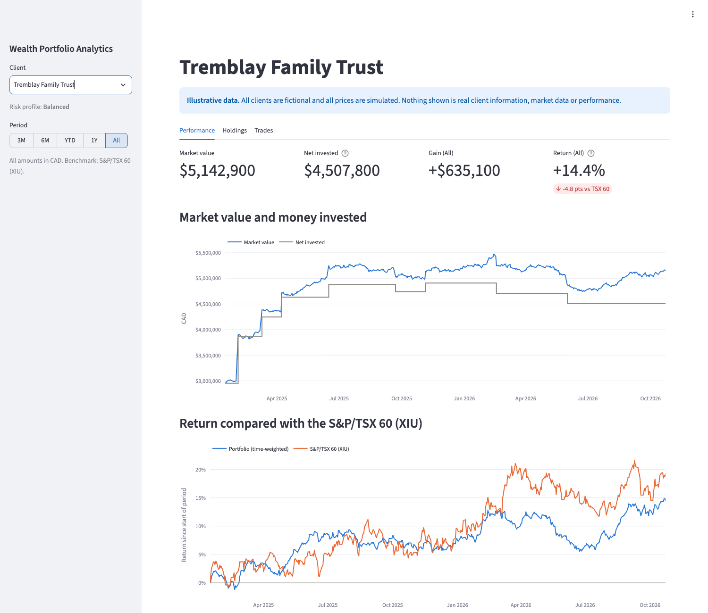
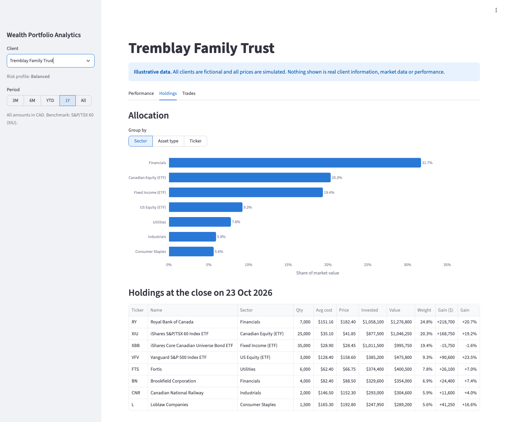

# Wealth Portfolio Analytics

[](https://github.com/Max123-cloud37672/wealth-portfolio-analytics/actions/workflows/ci.yml)

Portfolio analytics for high-net-worth (HNW) clients, built in Python on a local
MySQL database with a Streamlit dashboard. Each client's portfolio is rebuilt
from their buy and sell history. The dashboard then shows what they hold, what
it is worth, how it has performed over time (time-weighted return) and how
that compares with the S&P/TSX 60.

> **Illustrative data only.** All clients are fictional and all prices are
> simulated. The tickers are real Canadian listings, used only so the example
> looks familiar. Nothing in this project is real client information, real
> market data, real investment performance or a recommendation.



## Features

- **Four fictional clients** of different sizes and risk profiles, from a
  ~$300K growth account to a ~$5M balanced family trust, with 45 trades between
  January 2025 and October 2026.
- **Period picker** (3M, 6M, YTD, 1Y, All): every figure and chart updates.
- **Headline figures:** market value, net invested, gain over the period and
  time-weighted return against the TSX 60 benchmark.
- **Performance charts:** market value against money invested, and the
  portfolio's return against the benchmark, measured from the same start date.
- **Holdings:** every open position with average cost, value, weight and gain,
  plus allocation by sector, asset type or ticker.
- **Trades:** the full history, filterable by ticker and side, and a form that
  records a new trade in MySQL. Before saving, the trade is checked against the
  client's history, so it can never sell shares the client did not hold.



## Running it

You need Python 3.14 and a local MySQL server (developed on MySQL 9.7).

```bash
python3.14 -m venv .venv
source .venv/bin/activate
pip install -r requirements.txt

cp .env.example .env                    # then put your MySQL password in .env
python -m wealth_analytics.sample_data  # creates the database and loads the sample data
streamlit run app/dashboard.py
```

The dashboard opens at <http://localhost:8501>. `.env` is listed in
`.gitignore`, so the password is never committed. To discard trades entered in
the dashboard and reload the sample data, run
`python -m wealth_analytics.sample_data --reset`.

## Key calculations

**Average cost.** Buying more shares re-weights the average cost. Selling
reduces the share count but leaves the average cost unchanged.

| Trade | Shares | Average cost | Realized gain |
|---|---|---|---|
| Buy 100 at $10 | 100 | $10.00 | |
| Buy 100 at $20 | 200 | $15.00 | |
| Sell 50 at $18 | 150 | $15.00 | (18 − 15) × 50 = **$150** |

**Gains.**

| Measure | Formula |
|---|---|
| Net invested | money put in by purchases − money taken out by sales |
| Total gain | market value − net invested (this includes realized gains) |
| Unrealized gain on a position | shares × today's price − shares × average cost |

A test checks, for every sample client, that *total gain = realized gain +
unrealized gain*, using two independent calculations.

**Time-weighted return (TWR).** TWR measures how the *investments* performed,
regardless of when the client added or withdrew money. Trades are treated as
happening at the day's close. Each day's return is the overnight change in
value of the shares already held:

```
daily return = (market value today − today's purchases + today's sales)
               ÷ market value yesterday − 1
TWR          = (1 + r₁) × (1 + r₂) × … × (1 + rₙ) − 1
```

*Example:* a client invests $1,000 and it rises 10% to $1,100. They then add
$1,100, and the combined $2,200 rises another 10% to $2,420.

- The simple gain on money put in is $320 ÷ $2,100 = **15.2%**. The timing of
  the deposit distorts this figure.
- The TWR is 1.10 × 1.10 − 1 = **21%**, which is what the investments
  actually returned.

The **benchmark return** is the price return of XIU (iShares S&P/TSX 60 ETF)
over the same period.

## Design

```
data/*.csv ──► sample_data ──► MySQL ◄──► repositories ──► domain objects ──► reporting ──► Streamlit
                                          (all the SQL)   Transaction         (tables,      (display
                                                          Portfolio           summaries)     only)
                                                          Performance
```

- **The portfolio is calculated, not stored.** MySQL holds only the facts:
  clients, trades, securities and daily prices. Positions, average costs and
  returns are worked out by replaying the trades in date order, so every number
  on the dashboard can be traced back to individual trades.
- **Repository pattern.** `ClientRepository`, `TransactionRepository`,
  `SecurityRepository` and `PriceRepository` are the only code that writes SQL.
  The rest of the project works with Python objects. Every value is passed as a
  query parameter, never pasted into the SQL text, which prevents SQL injection.
- **Rules are enforced twice.** The Python classes reject invalid inputs, such
  as a zero quantity or a blank ticker, when they are created. MySQL also
  enforces `CHECK`, `UNIQUE` and foreign-key constraints, so bad rows can't get
  in through another route either.
- **Immutable value objects.** `Transaction`, `Position`, `Client` and
  `Security` are frozen dataclasses, so a trade can't be changed after it is
  created.
- **No finance logic in the dashboard.** `app/dashboard.py` only formats and
  displays results from `wealth_analytics`, so every number is testable
  without a browser.

### Database schema

| Table | Key | Columns |
|---|---|---|
| `clients` | `client_id` | name (unique), risk (`Conservative`, `Balanced` or `Growth`) |
| `transactions` | `transaction_id` | client_id → clients, trade_date, ticker, side (`Buy` or `Sell`), quantity, price |
| `securities` | `ticker` | name, asset_type (`Stock` or `ETF`), sector |
| `prices` | (`ticker`, `price_date`) | close; ticker → securities |

### Simulated prices

`data/prices.csv` is generated, not downloaded. Each ticker's price series
passes exactly through every sample trade price, with random daily moves in
between. In statistics this is called a *Brownian bridge*. Bond ETFs are given
the smallest daily moves and growth stocks the largest. A fixed random seed
makes the file reproducible (`python -m wealth_analytics.price_simulation`),
and a test checks that every trade happened at that day's closing price.

## Testing

```bash
pytest
ruff check .
```

The suite has 114 tests, each written before the code it tests. The database
tests run against a separate `wealth_analytics_test` database, which is emptied
before every test, so the real data is never touched.

| Test file | Tests | Covers |
|---|---|---|
| `test_transaction.py` | 11 | trade amounts, buy/sell direction, validation, immutability |
| `test_position.py` | 6 | average cost after buys and sells, validation |
| `test_portfolio.py` | 11 | replaying trades, realized gains and losses, overselling, date order |
| `test_performance.py` | 10 | daily values, gains, TWR including the 21% example, partial periods |
| `test_price_history.py` | 5 | price lookups, weekends, unknown tickers |
| `test_reporting.py` | 14 | periods, headline summary, chart data, holdings and trade tables |
| `test_repositories.py` | 10 | saving and loading every table in MySQL, duplicate and unknown keys |
| `test_trade_book.py` | 4 | new trades: valid, overselling, back-dated sales, unknown tickers |
| `test_sample_data.py` | 10 | CSV parsing, data consistency, the gain cross-check, loading and `--reset` |
| `test_price_simulation.py` | 8 | anchors hit exactly, weekdays only, reproducibility |
| `test_dashboard.py` | 10 | the page runs, figures, switching client and period, recording and refusing trades |
| other (`client`, `security`, `database_config`, `setup`) | 15 | validation, settings, the password is never printed |

GitHub Actions runs Ruff and the full suite on every pull request. It starts
its own MySQL 9.7.4 service, so the database tests run in CI too. See
[`.github/workflows/ci.yml`](.github/workflows/ci.yml).

## Project structure

```
app/dashboard.py              Streamlit page (display and input only)
src/wealth_analytics/
    transaction.py            Transaction: one buy or sell trade
    position.py               Position: shares held and average cost
    portfolio.py              Portfolio: replays trades into positions and realized gain
    price_history.py          PriceHistory: closing-price lookups
    performance.py            Performance: daily values and time-weighted return
    reporting.py              tables and summaries for the dashboard
    trade_book.py             TradeBook: validates and records new trades
    client.py, security.py    reference data classes
    database.py, schema.py    MySQL connection settings and table definitions
    repositories.py           all SQL: save and load each table
    sample_data.py            loads data/*.csv into MySQL
    price_simulation.py       generates data/prices.csv
    validation.py             shared input checks
data/                         fictional clients, trades, securities and simulated prices
tests/                        pytest suite
.github/workflows/ci.yml      continuous integration with a MySQL service
DEVLOG.md                     decisions, problems and what I learned
```

## Assumptions and limitations

- Canadian-listed stocks and ETFs only, with all amounts in CAD.
- Prices are simulated. Weekdays are treated as trading days, ignoring market
  holidays.
- Trades settle at the day's closing price. Dividends, fees, taxes and cash
  balances are not modelled, so returns are price returns.
- Average cost is the method used for Canadian tax reporting, but tax
  calculations are out of scope.
- The trade form trusts whoever is using the dashboard. A real system would
  add user accounts and an audit trail.

**Possible next steps:** dividends and a cash account, US holdings with
USD→CAD conversion, live prices from a market-data provider, and risk measures
such as volatility and maximum drawdown.

## How this was built

This is a learning project, built in October 2026 with Claude (Anthropic's AI
assistant) as a coding tutor. It follows an earlier, simpler project,
[Personal-Portfolio-](https://github.com/Max123-cloud37672/Personal-Portfolio-).
Claude wrote the code and tests and explained each part as it went. I chose the
project's direction and requirements (Python with a local MySQL database,
transactions, performance over time and an interactive dashboard), approved
each step, ran the code and tests locally, and made every commit and pull
request myself. The [DEVLOG](DEVLOG.md) records the decisions, the problems I
hit and what I learned.
